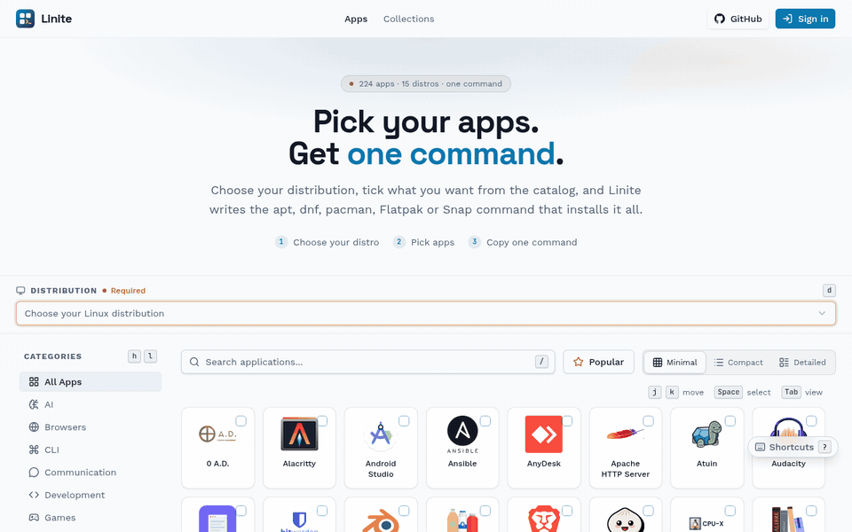
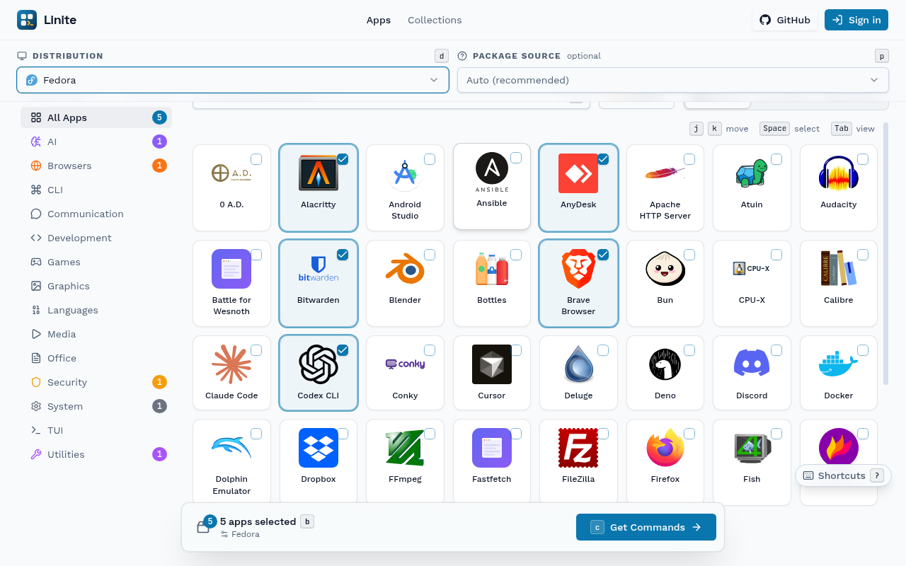
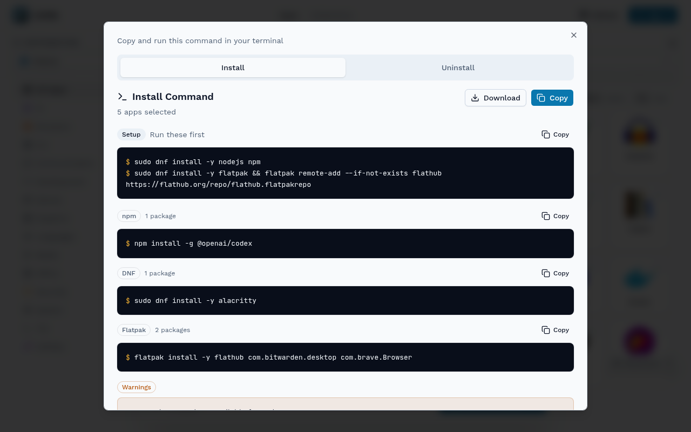
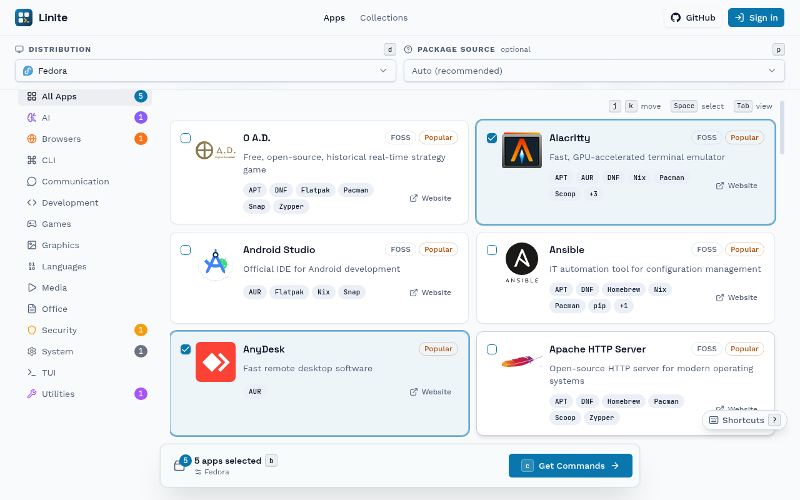
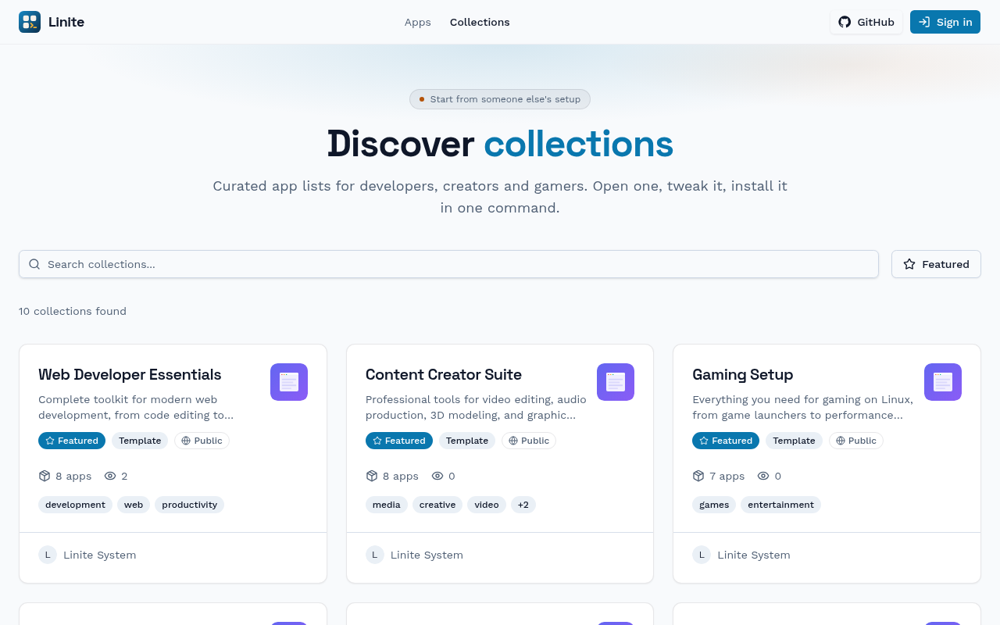
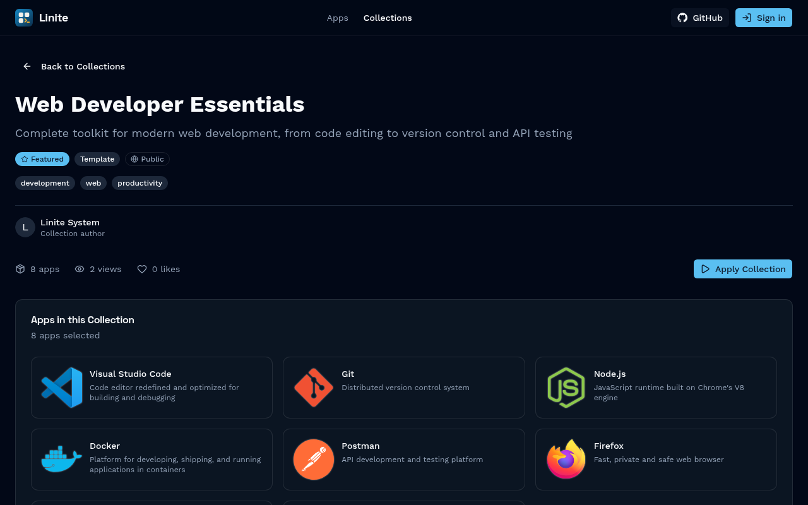
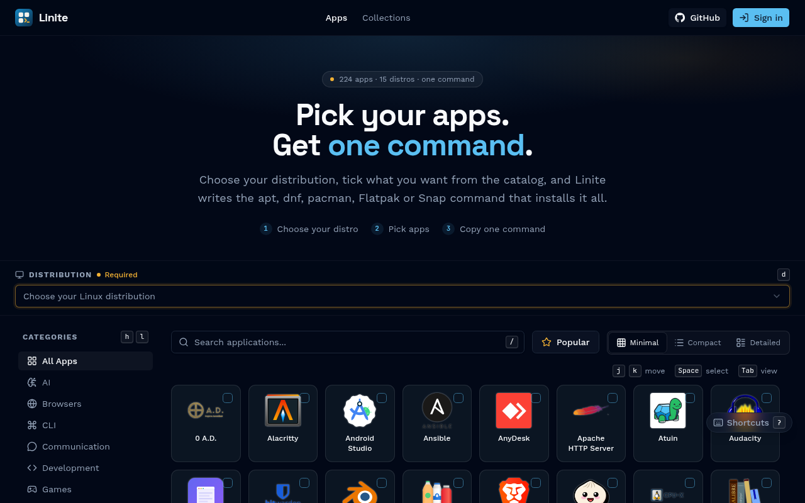

<p align="center">
  
</p>

<h1 align="center">Linite</h1>

<h3 align="center">Pick your apps. Get one command.</h3>

<p align="center">
  <a href="https://linite.sagyamthapa.com.np">Try it</a> ·
  <a href="#tour">Tour</a> ·
  <a href="#works-with">Works with</a> ·
  <a href="#quick-start">Quick start</a> ·
  <a href="CONTRIBUTING.md">Contributing</a>
</p>

<p align="center">
  <b>A Ninite-style bulk installer for Linux.</b><br>
  Choose your distro, tick apps from a curated catalog, and copy the apt, dnf, pacman, Flatpak or Snap command that installs them all.
</p>

<p align="center">
  
  
  
  
  
  
  <br>
  
  
  
  
  
</p>

<p align="center">
  
</p>

## Tour

<table>
<tr>
<td width="50%"><br><b>Pick.</b> Tick apps from 14 categories. The bar at the bottom keeps count.</td>
<td width="50%"><br><b>Copy.</b> One block per package manager, setup steps first, and a warning for anything your distro lacks.</td>
</tr>
<tr>
<td><br><b>Compare.</b> The detailed view lists every source an app ships through.</td>
<td><br><b>Collections.</b> Start from a curated list for developers, creators or gamers.</td>
</tr>
<tr>
<td><br><b>Share.</b> Save your own lists, share them, and apply one in a click.</td>
<td><br><b>Light or dark, keyboard first.</b> <code>/</code> to search, <code>j</code> <code>k</code> to move, <code>Space</code> to pick, <code>c</code> for the command.</td>
</tr>
</table>

## Works with

<p>
  
  
  
  
  
  
  
  
  
  
  
  
  
  
  
</p>
<p>
  
  
  
  
  
  
  
  
  
  
  
</p>

## Quick start

```bash
git clone https://github.com/Sagyam/linite.git
cd linite
bun install
cp .env.example .env   # fill in, see docs/ENVIRONMENT.md
bun run db:push && bun run db:seed
bun run dev            # http://localhost:3000
```

More in [CONTRIBUTING.md](CONTRIBUTING.md) and [docs/](docs).

## Credits

Inspired by [Ninite](https://ninite.com/). Package data from [Flathub](https://flathub.org/), [Snapcraft](https://snapcraft.io/), [AUR](https://aur.archlinux.org/), [Homebrew](https://formulae.brew.sh/) and [Repology](https://repology.org/). MIT licensed, see [LICENSE](LICENSE).
